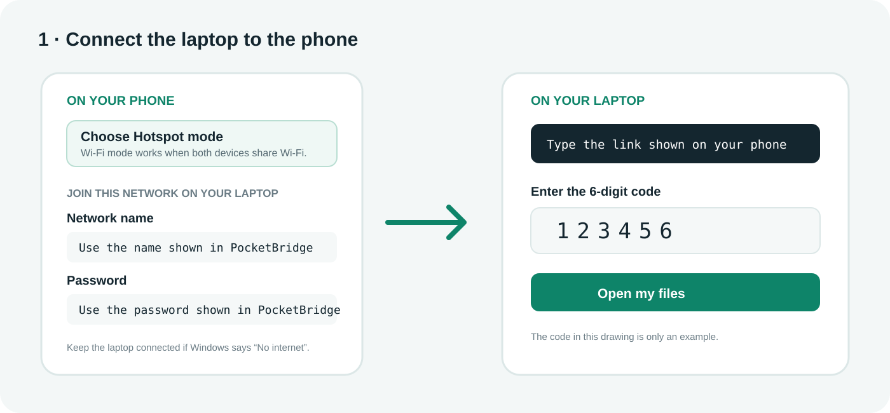
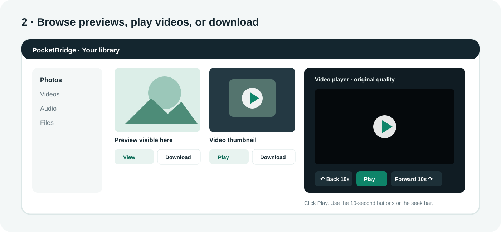
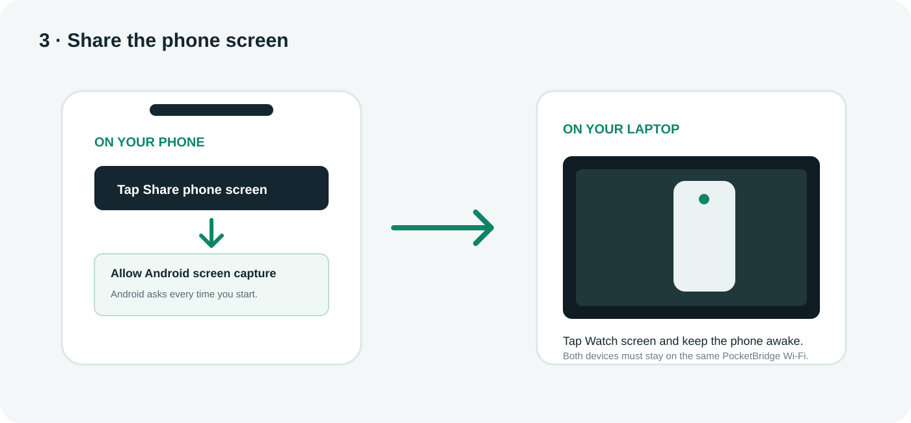

# PocketBridge Quick Start (Android 15)

This guide shows how to share files and your phone screen with a laptop. The laptop needs a browser only; file sharing and screen streaming work over the local Wi-Fi link without mobile data or internet.

## 1. Connect the laptop

1. Open PocketBridge on the phone and allow **Nearby Wi-Fi** access. Allow access to the photos and videos you want to share.
2. For the easiest offline connection, tap **Hotspot mode**. The phone shows a Wi-Fi network name, password, link, and six-digit code.
3. On the laptop, join the Wi-Fi network shown by PocketBridge. If Windows warns that this network has no internet, choose to stay connected.
4. Open the exact link shown on the phone. Type the six-digit code and tap **Open my files**.

**Wi-Fi mode:** tap it when the laptop is already on the same Wi-Fi as the phone. The laptop may need the usual router password to join. Android does not let PocketBridge read or show a saved Wi-Fi password.

## 2. Preview, play, or download files

- Photos and video thumbnails appear in the grid. Select **Photos**, **Videos**, **Audio**, or **Files** to narrow the list.
- Tap **View** or a photo preview to open a photo. Tap **Play** or a video thumbnail to open a video.
- In the player, tap **Play**, **↶ Back 10s**, or **Forward 10s ↷**. The seek bar also moves through the video; the left and right arrow keys skip ten seconds while the player is open.
- Tap **Download** to save the original file on the laptop. Videos are not converted or compressed.

Keep PocketBridge open on the phone while previews, playback, or downloads are in progress. Large files can take longer on a slow Wi-Fi connection.

## 3. Share the phone screen

1. Keep the phone and laptop on the same Wi-Fi network or PocketBridge hotspot.
2. Tap **Share phone screen** in PocketBridge on the phone.
3. Approve Android's screen-capture prompt. Android asks for this approval each time.
4. On the laptop, tap **Watch screen**. Keep PocketBridge open and the screen on while sharing.

To stop, tap **Stop viewing** in the browser and **Stop sharing** in PocketBridge.

## If something does not work

- **The Wi-Fi name is missing:** on Android 13 or newer, enable PocketBridge's **Nearby Wi-Fi devices** permission in Android Settings → Apps → PocketBridge → Permissions, then stop and restart sharing. On older Android versions, enable the requested location permission; Android uses it to reveal the connected Wi-Fi name.
- **The link does not open:** confirm both devices are on the same Wi-Fi, retype the exact link, keep the phone share active, and try the other link shown on the phone. If router Wi-Fi mode blocks device-to-device connections, use Hotspot mode.
- **A preview is blank:** leave the page open for a moment. If the phone's media provider has no thumbnail, PocketBridge tries a fallback preview; downloading still transfers the original.
- **A video does not play:** retry while the phone is still sharing. Some video codecs are unsupported by a browser; use **Download** to save the original and play it on the laptop.
- **Screen sharing stays on “Connecting”:** confirm the Android capture permission was approved, both devices remain on the same network, and PocketBridge stays open. Stop capture on the phone, start it again, then tap **Watch screen**.
- **A large download pauses:** keep the phone unlocked and sharing, keep the laptop connected to the hotspot, and retry the download.

PocketBridge transfers files directly from the phone over the local network. Screen video uses an encrypted peer-to-peer WebRTC connection. Do not share the one-time code with people you do not trust.
